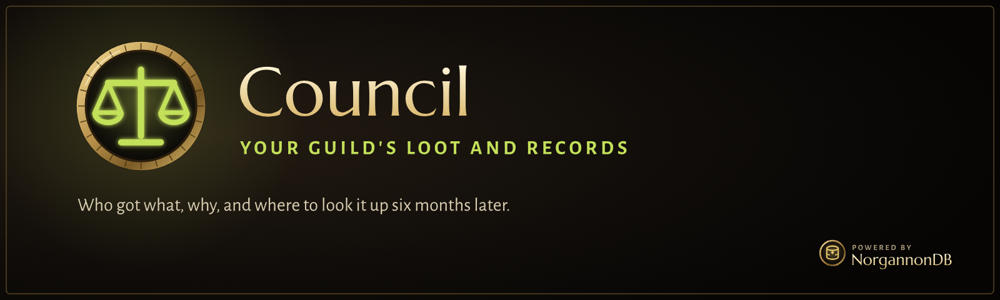

  

  
  
  

> [!WARNING]
> **Very much a work in progress.** This first stage has passed its test harness but hasn't been played in the game, and multi-player
> behaviour needs real guild members to check. Expect things to need fixing.

**Council runs a guild's loot and keeps its records.** Every drop goes to the right person by your own rules, everyone can see why, and you
can look it up six months later.

## What it does

### Loot night
Open a corpse, and each drop worth rolling on is listed with who's in line and why. Announce with a click, watch `/roll`s come in, see ties,
and give the item with one more click. People without the add-on just `/roll` as usual.

### Reserves and SR+
Paste a reserve list. Because NorgannonDB knows what drops where, Council catches a reserve that can't drop here, someone who isn't in the
raid, and anyone with nothing reserved, before the pull. SR+ follows your guild's rules: the bonus, a cap, what resets it, how ties settle.

### History
Who got what, by raid, boss or player, in raids and dungeons, whether or not an officer was there. Every line shows how many clients saw it,
and corrections never erase anything.

### A shared record
Every guild member's copy of the record syncs in the background, so losing your files costs nothing: log in and it comes back.

**It makes tampering visible, not impossible.** The game vouches for who sent a message and what rank they hold, and a changed entry breaks
a chain of hashes. Nothing in this client can sign, and officers are trusted by rank.

## Using it
`/council` opens the window. `/council status` says where things stand. Needs NorgannonDB and NorgannonDB Core.

## Coming later
Priority lists, council votes and reserving in game. Then guild tools: alts, notes, a promotions queue and log readers.

## Licence
All rights reserved. See [LICENSE](LICENSE).
